# ⚡ QIEZKA

<div align="center">

```
   ██████╗ ██╗███████╗███████╗██╗  ██╗ █████╗ 
  ██╔═══██╗██║██╔════╝╚══███╔╝██║ ██╔╝██╔══██╗
  ██║   ██║██║█████╗    ███╔╝ █████╔╝ ███████║
  ██║▄▄ ██║██║██╔══╝   ███╔╝  ██╔═██╗ ██╔══██║
  ╚██████╔╝██║███████╗███████╗██║  ██╗██║  ██║
   ╚══▀▀═╝ ╚═╝╚══════╝╚══════╝╚═╝  ╚═╝╚═╝  ╚═╝
```

### *This app is specifically made for me, do not blame me for bricked phones*

[-3DDC84?style=for-the-badge&logo=android&logoColor=white)](https://developer.android.com/)
[](https://react.dev/)
[](https://capacitorjs.com/)
[](https://vitejs.dev/)
[](https://tailwindcss.com/)
[](https://aistudio.google.com/)
[](https://developer.android.com/guide/topics/admin/device-admin)
[](https://developer.android.com/reference/android/view/WindowManager.LayoutParams#TYPE_APPLICATION_OVERLAY)
[](#-online-architecture--offline-resources-byok)
[](LICENSE)

<br/>

**[⚡ Philosophy](#-philosophy-procrastination-prevention)** • 
**[⚖️ Comparison Matrix](#%EF%B8%8F-qiezka-vs-traditional-app-blockers)** • 
**[🏗️ Architecture](#%EF%B8%8F-system-architecture)** • 
**[🧠 Local App Classifier](#-local-app-classifier-engine-on-device-5-layer-heuristics)** • 
**[🚨 Consequence Lockdown](#-consequence-lockdown--operating-hours-700-pm--300-am)** • 
**[⚡ Operating Modes: Safemode vs Hardcore](#-operating-modes-safemode-vs-hardcore-247)** • 
**[🌐 Web & Browser Protection](#-web--browser-protection-accessibility-guard--local-dns-sinkhole)** • 
**[📰 Case Studies](#-case-studies--article-declutter-system)** • 
**[🔮 Floating Ball Overlay](#-floating-assistive-timer-ball)** • 
**[📋 App Directory](#-complete-application-reference-blocked--allowed)** • 
**[🛡️ Anti-Cheat & Security](#%EF%B8%8F-security--anti-cheat-architecture)** • 
**[🚀 Setup & ADB](#-setup-guide)** • 
**[📱 OEM Guides](#-oem-rom-optimization-guide)** • 
**[📂 Codebase Tour](#-codebase-architecture--tour)** • 
**[📜 Engineering Changelog](#-engineering-changelog--architecture-evolution-log)** • 
**[🔮 Future Roadmap & Forks](#-future-roadmap--ecosystem-forks)** • 
**[❓ FAQ](#-frequently-asked-questions-faq)**

</div>

SIREN 🛡️
High-Security Offline Android Focus & Anti-Distraction Engine


SIREN is a professional-grade, open-source focus lockdown utility for Android. By utilizing Device Owner administrative privileges (similar to corporate IT policies) combined with a local Edge AI Screen Sniper, Halanoi makes it virtually impossible to bypass your focus session or sneak past your study blocks.

---


## 🚀 Key Features

### 1. 3-Stage App Classifier 🧠
*   Stage 1 — Master Veto Gate: 
Android Settings, all OEM Phone Managers (MIUI Security Center, Samsung Device Care, ColorOS SafeCenter), and hardware bloatware (Joyose, GameCenter, PalmStore, Glance) are unconditionally blocked. Noexceptions, no appeal.
*   Stage 2 — Evaluation:
Apps on the KnownSafe.kt are allowed, Apps on the KnownDistracting.kt are blocked.
Qiezka uses table in order to know if it should block an app or not + Unified Policy toggle.
If an App is Undefined Qiezka will try to Evaluate it
CATEGORY_GAME always blocked. CATEGORY_SOCIAL blocked. CATEGORY_VIDEO and CATEGORY_NEWS blocked. CATEGORY_PRODUCTIVITY allowed. Combined with Positive and Negative Signals
*   Stage 3 — Universal System Gateway:
Apps on the OEM system partition (FLAG_SYSTEM) that passed all veto gates are allowed as legitimate hardware infrastructure.
*   Layer 5 — Conservative Fallback:
Unknown user-installed app with no category, no academic signals, not system-partitioned → blocked.
### 2. 2-Stage Web and PWA/TWA Classifier 🌐
*   Stage 1 — Evaluation: 
URL on KnwonSafeWeb.kt are allowed, URK on the KnownDistracting.kt are blocked.
Qiezka uses table in order to know if it should block a URL or not + Unified Policy toggle.
If a URL is Undefined Qiezka will try to Evaluate it
Live Chromium DOM scan reads the page's accessibility tree — academic signals promote it, distraction signals block it.
*   Stage 2 — Conservative Fallback:
Unknown URL with no academic signals, with or without distraction signals are Blocked.

### 3. Anti-Bypass Stack ⚔️
*   Device Admin — blocks uninstall.
*   Accessibility Service — Follows 3-Stage App Classifier and 2-Stage Web and PWA/TWA Classifier
*   Quick Settings Collapse — QS panel collapses via StatusBar reflection the moment it's expanded during lockdown (not working)
*   Home Shell Proxy (QiezkaHomeHandlerActivity holds ROLE_HOME) — pressing Home auto-revives the enforcement process if force-stopped. Delegation target validated against Stage 1 veto to prevent spoofing.
*   Launcher Change Interception — isFastHomeRoleEvent() detects role change dialogs sub-millisecond. 4-burst retry at 0/25/60/120ms dismisses the picker before it finishes inflating.
*   Boot Persistence — BootReceiver + AlarmManager exact alarms fire on ACTION_BOOT_COMPLETED. If lockdown was active, it resumes. If timer expired while powered off, Consequence Mode activates immediately.
*   Sideloaded Apps Detection — newly installed apps detected via installer/store package monitoring are immediately classified via 3-Stage App Classifier 🧠

---

## 🛠️ Step-by-Step Setup Guide:
To run SIREN Quiz App, your device must do the following steps:
On-Device or ADB

### 📱 On-Device Setup

Grant each permission directly from within the app via in-app buttons:

| Permission | Type | Purpose |
|---|---|---|
| Accessibility Service | **Essential** | Intercepts distracting apps and Websites |
| Notifications | **Essential** | Countdown alerts, warnings |
| Unrestricted Background | **Essential** | Prevents OEM battery killers from stopping enforcement |
| Device Administrator | **Essential** | Blocks uninstalling QIEZKA during lockdown |

> On Android 13+: if Accessibility appears greyed out, tap **App Info** inside the onboarding — then tap the three-dot menu → *Allow restricted settings* — then return and grant it.

### 📱 ADB Setup (via `qiezka.bat`)

**Prerequisites:**
- PC
- Android platform-tools (ADB) installed in PC
- USB Debugging enabled on your phone (Developer Options)
- Phone connected via USB and authorized

**Run the script:**
```
Double-click qiezka.bat and at the User Account Control pop-up select yes
```

The script runs the following steps:
1. Automatic single device Detected, User controlled if multiple devices detected
2. Installs the APK (or updates it keeping all existing data)
3. Grants system permissions
4. Whitelists QIEZKA from aggressive OEM battery killers (Samsung, Xiaomi, Pixel)

After the script finishes, QIEZKA launches automatically on your phone. **Disconnect the USB — setup is complete.**

---

---

**Try setting SIREN as Home, something boringly magical happens if you force stop SIREN via ADB**

---
**App was tested on:**
- Redmi Note 12 4G (tapas) running Android 16 QPR1 Evolution-X 11.5 ROM
- SAMSUNG Galaxy A30 running Android 11 One UI 3.1

**App Flow**

```mermaid
flowchart TD

    %% ----------------------------------------------------
    %% 0. UNIFIED POLICY REGISTRY & USER UI CONFIGURATION
    %% ----------------------------------------------------
    subgraph SUB_POLICY ["0. Unified Service Policy Engine (Dev Registry & UI Config)"]
        REG_DEV["<b>Developer Registry</b><br>• <b>YouTube</b>: com.google.android.youtube + youtube.com<br>• <b>Gemini</b>: com.google.android.apps.gemini + gemini.google.com<br>• <b>OpenAI</b>: com.openai.chatgpt + chatgpt.com<br>• <b>Claude</b>: com.anthropic.claude + claude.ai"]:::devNode --> UI_TOGGLE(["👤 User Toggles Service in App UI<br>(Allow Gemini / OpenAI / Claude / YouTube)"]):::uiNode
        UI_TOGGLE --> SYNC_POLICY["🔄 Synchronize uncode_lock.xml & Invalidate Caches<br>• Package IDs synced to <b>KnownSafe</b><br>• Web Domains synced to <b>KnownSafeWeb</b><br>• AppClassifier & WebClassifier caches cleared"]:::bridgeNode
    end

    %% ----------------------------------------------------
    %% 1. BOOT & STARTUP LIFECYCLE
    %% ----------------------------------------------------
    BOOT_START(["🔄 User Restarts Device<br>Device Reboots / Powers On"]):::startNode --> OS_INIT["📱 Android OS Boot Completed<br>System Server Initializes"]:::actionNode
    OS_INIT --> BROADCAST_BOOT["📡 Android Dispatches<br>ACTION_BOOT_COMPLETED"]:::actionNode
    OS_INIT --> BIND_A11Y["⚙️ Android AccessibilityManager<br>Binds LockAccessibilityService"]:::actionNode

    subgraph SUB_BOOT ["1. BootReceiver Execution"]
        BROADCAST_BOOT --> BOOT_RCV["📥 BootReceiver.kt onReceive()"]:::actionNode
        BOOT_RCV --> RESCHED_ALL["⏰ ScheduleManager.rescheduleAll()<br>Re-register AlarmManager exact alarms"]:::actionNode
        RESCHED_ALL --> READ_PREFS_BOOT["📖 Read uncode_lock.xml<br>lockdown_active, lock_end_time, schedules, policies"]:::actionNode

        READ_PREFS_BOOT --> CHECK_WAS_LOCKED{"Was lockdown active<br>before restart?"}:::gateNode
        
        CHECK_WAS_LOCKED -- "Yes" --> CHECK_TIME_EXP{"Did timer expire while<br>device was powered off?"}:::gateNode
        CHECK_TIME_EXP -- "Yes (now >= lockEndTime)" --> EXPIRE_TO_CONSEQUENCE["Clear lockdown_active<br>Set consequence_active = true"]:::blockNode
        CHECK_TIME_EXP -- "No (Lockdown still active)" --> RESCHED_ALARM["Reschedule Alarm &<br>Relaunch QIEZKA to foreground"]:::actionNode

        CHECK_WAS_LOCKED -- "No" --> CHECK_BOOT_SCHED{"Check Active Schedules<br>Status on Boot"}:::gateNode
        CHECK_BOOT_SCHED -- "Window Missed While Off<br>(now >= scheduledEnd)" --> MISSED_CONSEQUENCE["⚠️ Missed lock while powered off<br>Set consequence_active = true"]:::blockNode
        CHECK_BOOT_SCHED -- "Currently Inside Window<br>(start <= now < end)" --> BOOT_START_LOCK["🔒 Lockdown starts immediately<br>Relaunch QIEZKA to foreground"]:::actionNode
        CHECK_BOOT_SCHED -- "Upcoming Schedule<br>(now < start)" --> EVENT_OR_TICK
        CHECK_BOOT_SCHED -- "No Schedules Exist" --> ALLOW_IDLE
    end

    subgraph SUB_A11Y ["2. LockAccessibilityService Startup"]
        BIND_A11Y --> A11Y_CONNECTED["🔌 onServiceConnected()"]:::actionNode
        A11Y_CONNECTED --> START_TICKER["⏱️ Start 500ms Ticker<br>onTickerTick()"]:::actionNode
        A11Y_CONNECTED --> USER_UNLOCK["🔓 User Unlocks Device /<br>Launcher Homescreen Loads"]:::actionNode
    end

    USER_UNLOCK --> EVENT_OR_TICK["📱 App Launch / Window Event / Ticker"]:::actionNode
    START_TICKER --> EVENT_OR_TICK
    RESCHED_ALARM --> EVENT_OR_TICK
    EXPIRE_TO_CONSEQUENCE --> EVENT_OR_TICK
    MISSED_CONSEQUENCE --> EVENT_OR_TICK
    BOOT_START_LOCK --> EVENT_OR_TICK

    %% ----------------------------------------------------
    %% 2. BACKUP IMPORT PIPELINE (ENTRY POINT)
    %% ----------------------------------------------------
    IMPORTSTART(["📥 User Selects Backup JSON<br>(Native SAF / Web File Picker)"]):::startNode --> PARSE["1. Parse JSON Payload<br>• Extract settings, allowedApps, customApps, activeServices"]:::actionNode

    PARSE --> STRUCT_VALID{"Valid Schema &<br>Non-Empty Data?"}:::gateNode
    STRUCT_VALID -- "No" --> REJECT_CORRUPT["❌ Abort: 'Invalid or Corrupt Backup'"]:::blockNode
    STRUCT_VALID -- "Yes" --> IMPORT_LOOP["2. Loop Each Candidate Package (pkg)<br>in data.allowedApps & customApps"]:::actionNode

    %% ----------------------------------------------------
    %% 3. STATE EVALUATION & STAGE 1 MASTER VETO
    %% ----------------------------------------------------
    EVENT_OR_TICK --> CHECK_LOCK_STATE{"Is Consequence Active<br>or Lockdown Active?"}:::gateNode

    CHECK_LOCK_STATE -- "Lockdown is Active" --> S1
    CHECK_LOCK_STATE -- "Consequence is Active" --> CHECK_MODE{"Operating Mode?"}:::gateNode

    %% STANDBY ENFORCEMENT GATE
    CHECK_LOCK_STATE -- "Neither Active" --> CHECK_ACTIVE_SCHED{"Are there any<br>Active Schedules?"}:::gateNode
    CHECK_ACTIVE_SCHED -- "No (Zero Schedules)" --> ALLOW_IDLE["✅ <b>ALLOW ALL (Total System Idle)</b><br>Settings, launcher & app installs allowed"]:::allow
    CHECK_ACTIVE_SCHED -- "Yes (Standby Protection)" --> S1

    CHECK_MODE -- "Hardcore" --> ENFORCE_247["🛡️ Enforce 24/7 Consequence"]:::gateNode --> S1
    CHECK_MODE -- "Safemode" --> CHECK_HOURS{"Time between<br>7:00 PM & 3:00 AM?"}:::gateNode
    CHECK_HOURS -- "Yes (Night)" --> S1
    CHECK_HOURS -- "No (Daytime 3am-7pm)" --> ALLOW_IDLE

    IMPORT_LOOP --> S1

    S1{"<b>STAGE 1 — MASTER VETO GATE</b><br>• Anti-Tamper (Settings, Security Center, Device Care)<br>• Hardware Task Killers (Joyose, GameSpace, Glance)<br>• Home Launcher Selection Dialog (PROCESS EXACTLY, NOT WORD MATCHING)<br><i>(Uninstall dialog completely unblocked)</i>"}:::stage

    S1 -- "❌ ANY VETO MATCH" --> ROUTE_S1{"Context?"}:::decisionNode
    ROUTE_S1 -- "Runtime Event" --> BLOCK["🚫 <b>BLOCK AND EVICT TO QIEZKA</b><br>(Direct launch, no flicker, no Back key)"]:::block
    ROUTE_S1 -- "Backup Import" --> PURGE_S1["🚫 <b>PURGE PACKAGE</b><br>(Drop from imported list)"]:::blockNode
    
    %% STAGE 1 PASSED: ROUTE BY STATE
    S1 -- "✅ PASSED VETO" --> ROUTE_PASS{"Context?"}:::decisionNode

    ROUTE_PASS -- "Runtime Event" --> CHECK_ACTIVE_LOCK{"Is Lockdown or<br>Consequence Active?"}:::gateNode
    CHECK_ACTIVE_LOCK -- "No (Active Schedule Standby)" --> ALLOW_STANDBY["✅ <b>ALLOW NORMAL APP (Standby)</b><br>TikTok, games, browsers usable until schedule lock starts"]:::allow
    CHECK_ACTIVE_LOCK -- "Yes (Lockdown/Consequence)" --> S2{"<b>STAGE 2 — DUAL APP & WEB GATE</b>"}:::stage

    ROUTE_PASS -- "Backup Import" --> MSG_GATE

    %% ----------------------------------------------------
    %% 4. STAGE 2 — NATIVE APPLICATION & IMPORT PIPELINE
    %% ----------------------------------------------------
    S2 -- "Application" --> MSG_GATE["<b>KnownDistracting CHECK</b><br>Is package in internal KnownDistracting.kt?<br>(Social feeds, video, games, remote desktop)"]:::stage
    
    MSG_GATE --> MSG_GATE2["<b>KnownSafe CHECK (Unified Policy)</b><br>Is package in KnownSafe?<br>• QIEZKA + Keyboard IMEs<br>• Allowed Apps Whitelist<br>• <b>Active Unified Services (YouTube, Gemini, OpenAI, Claude)</b>"]:::stage
    
    SYNC_POLICY -.->|"Syncs Package IDs"| MSG_GATE2
    
    MSG_GATE2 --> MSG_GATE3{"Initial App Policy Result Classifier"}:::stage

    %% Native Truth Table
    MSG_GATE3 -- "YES KnownDistracting, YES KnownSafe<br>(e.g. Whitelisted YouTube / Gemini / OpenAI)" --> ROUTE_ALLOW{"Context?"}:::decisionNode
    MSG_GATE3 -- "NO KnownDistracting, YES KnownSafe<br>(e.g. Whitelisted Study App / Calculator)" --> ROUTE_ALLOW
    MSG_GATE3 -- "YES KnownDistracting, NO KnownSafe<br>(Unapproved Distraction)" --> ROUTE_BLOCK{"Context?"}:::decisionNode

    ROUTE_BLOCK -- "Runtime Event" --> BLOCK
    ROUTE_BLOCK -- "Backup Import" --> PURGE_S2["🚫 <b>PURGE PACKAGE</b><br>(Drop distraction from import)"]:::blockNode

    ROUTE_ALLOW -- "Runtime Event" --> ALLOW["✅ <b>ALLOW APP</b><br>Native application runs freely"]:::allow
    ROUTE_ALLOW -- "Backup Import" --> KEEP_PKG["✅ <b>KEEP PACKAGE</b><br>(Legitimate study app / policy enabled)"]:::allowNode

    MSG_GATE3 -- "NO KnownDistracting, NO KnownSafe" --> NO{"Secondary App Classifier"}:::decisionNode

    NO -- "Detected as Distracting Category<br>(Games, Video, Social Feeds, Remote Screen Share/VNC, Vaults)" --> ROUTE_BLOCK
    NO -- "Detected Academic & Productivity" --> ROUTE_ALLOW
    NO -- "❓ Clean Undefined App (Not a Distraction)" --> S3{"<b>STAGE 3 — UNIVERSAL SYSTEM GATEWAY</b>"}:::stage

    S3 -- "System Partition (FLAG_SYSTEM == true)" --> ROUTE_ALLOW
    S3 -- "User-Installed (FLAG_SYSTEM == false)" --> ROUTE_BLOCK

    %% ----------------------------------------------------
    %% 5. STAGE 2 — WEB BROWSER PIPELINE
    %% ----------------------------------------------------
    S2 -- "🌐 Web Browser" --> WEB_START(["🌐 Browser Window Active<br>(Chrome / Samsung Internet / PWA)"]):::startNode
    
    WEB_START --> WEB_ROOT_INSPECT["🔍 inspectBrowserWindow(root, pkg)"]:::actionNode
    
    WEB_ROOT_INSPECT --> VERIFICATION{"<b>1. VERIFICATION</b><br>Is it a Browser Search?<br>• URL: google.com/search, bing.com, etc.<br>• Active search input box"}:::gateNode
    
    VERIFICATION -- "YES (Search Results)" --> ALLOW_SEARCH["✅ <b>TOTAL ALLOW SEARCH RESULTS</b><br>Research is 100% immune.<br>Never inspected for blacklisted words.<br>Browsing including long press or specifics continues uninterrupted<br>(AS LONG AS USER IS IN THE SAME PAGE)."]:::allowNode
    
    VERIFICATION -- "NO (Destination Page)" --> WEB_URL_CHECK["<b>2. Extract URL</b><br>extractUrlFromBrowser()"]:::decisionNode
    
    WEB_URL_CHECK -- "URL Found<br>(Address bar visible)" --> WEB_CLASSIFY_URL["⚡ WebClassifier.classify(url)"]:::actionNode

    WEB_CLASSIFY_URL --> WEB_MSG_GATE["<b>KnownDistractingWeb CHECK</b><br>Is URL in internal KnownDistractingWeb?<br>(YouTube, TikTok, Netflix, web games, pirate streams)"]:::stage
    
    WEB_MSG_GATE --> WEB_MSG_GATE2["<b>KnownSafeWeb CHECK (Unified Policy)</b><br>Is domain in KnownSafeWeb?<br>• Academic domains (.edu, LMS, Wikipedia, Docs)<br>• <b>Active Unified Services (youtube.com, gemini.google.com, chatgpt.com, claude.ai)</b>"]:::stage
    
    SYNC_POLICY -.->|"Syncs Web Domains"| WEB_MSG_GATE2
    
    WEB_MSG_GATE2 --> WEB_MSG_GATE3{"Initial Web Policy Result Classifier"}:::stage

    %% Web Truth Table
    WEB_MSG_GATE3 -- "YES KnownDistractingWeb, YES KnownSafeWeb<br>(e.g. Whitelisted YouTube / Gemini)" --> WEB_ALLOW_BROWSER["✅ <b>TOTAL ALLOW WEB</b><br>Broadly allowed & uninterrupted.<br>(No complex DOM/video title checks)"]:::allowNode
    WEB_MSG_GATE3 -- "NO KnownDistractingWeb, YES KnownSafeWeb<br>(e.g. Wikipedia, Docs, Claude)" --> WEB_ALLOW_BROWSER
    
    WEB_ALLOW_BROWSER -- "Windows Changed / Entered new Domain / Clicked Link" --> WEB_ROOT_INSPECT
    
    WEB_MSG_GATE3 -- "YES KnownDistractingWeb, NO KnownSafeWeb<br>(e.g. TikTok, KissKH, y8.com)" --> WEB_REMEDIATE["🛡️ <b>Web Auto-Back (BLOCKS)</b><br>• Browser Tab: Press Back until safe site / Home<br>• IF PWA/TWA: BLOCK AND EVICT TO QIEZKA"]:::remediateNode
    
    WEB_MSG_GATE3 -- "NO KnownDistractingWeb, NO KnownSafeWeb<br>(Unclassified URL)" --> WEB_TREE_SCANS

    %% PWA / Occluded Address Bar direct branch
    VERIFICATION -- "URL is Null<br>(No address bar / Standalone PWA / TWA)" --> WEB_TREE_SCANS["🔎 Scan Chromium Accessibility View Tree<br>WebClassifier.classifyStandalonePwa()"]:::actionNode

    %% Secondary Web Classifier
    WEB_TREE_SCANS --> WEB_NO{"Secondary Web Classifier"}:::decisionNode
    WEB_NO -- "Detected Academic & Productivity" --> WEB_ALLOW_BROWSER
    WEB_NO -- "Detected as Distracting Web Category<br>(Games, Video, Social Feeds, Media Players)" --> WEB_REMEDIATE
    WEB_NO -- "❓ Clean Undefined Web" --> WEB_FALLBACK["⚠️ <b>LAYER 5 FALLBACK</b><br>Unknown Web Content"]:::fallback
    WEB_FALLBACK --> WEB_REMEDIATE

    %% ----------------------------------------------------
    %% 6. COMMIT SANITIZED BACKUP
    %% ----------------------------------------------------
    PURGE_S1 --> COLLECT_CLEAN["3. Collect All Surviving (KEEP) Packages"]:::actionNode
    PURGE_S2 --> COLLECT_CLEAN
    KEEP_PKG --> COLLECT_CLEAN

    COLLECT_CLEAN --> SYNC_CLEAN["4. Commit to uncode_lock.xml<br>• Write clean whitelist (no tampering / no distractions)<br>• Sync activeServices via setServicePolicy<br>• Invalidate Caches (AppClassifier, WebClassifier)"]:::bridgeNode
    SYNC_CLEAN --> RELOAD_APP(["🔄 5. App Reloads with Clean Hardened State"]):::startNode

    %% ----------------------------------------------------
    %% STYLING DEFINITIONS
    %% ----------------------------------------------------
    classDef startNode fill:#1e293b,stroke:#64748b,stroke-width:2px,color:#f8fafc;
    classDef actionNode fill:#0f172a,stroke:#3b82f6,stroke-width:2px,color:#f8fafc;
    classDef decisionNode fill:#1e1b4b,stroke:#818cf8,stroke-width:2px,color:#e0e7ff;
    classDef gateNode fill:#1e1b4b,stroke:#818cf8,stroke-width:2px,color:#fff;
    classDef stage fill:#312e81,stroke:#6366f1,stroke-width:2px,color:#e0e7ff;
    classDef allowNode fill:#064e3b,stroke:#10b981,stroke-width:2px,color:#d1fae5;
    classDef remediateNode fill:#78350f,stroke:#f59e0b,stroke-width:2px,color:#fef3c7;
    classDef fallback fill:#7f1d1d,stroke:#ef4444,stroke-width:2px,color:#fee2e2;
    classDef block fill:#f8d7da,stroke:#b02a37,stroke-width:2px,color:#000;
    classDef allow fill:#d1e7dd,stroke:#198754,stroke-width:2px,color:#000;
    classDef blockNode fill:#7f1d1d,stroke:#ef4444,stroke-width:2px,color:#fff;
    classDef devNode fill:#0f766e,stroke:#14b8a6,stroke-width:2px,color:#fff;
    classDef uiNode fill:#0369a1,stroke:#38bdf8,stroke-width:2px,color:#fff;
    classDef bridgeNode fill:#4338ca,stroke:#818cf8,stroke-width:2px,color:#fff;

```




